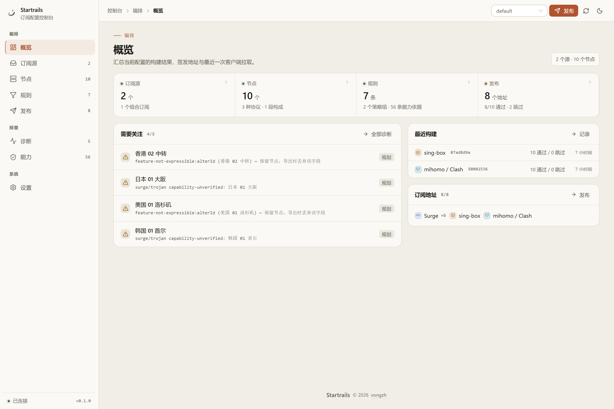
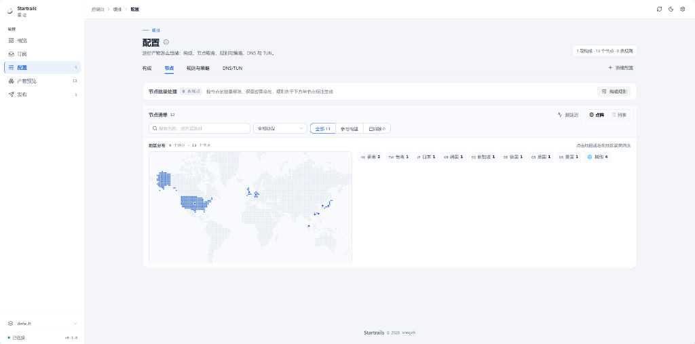
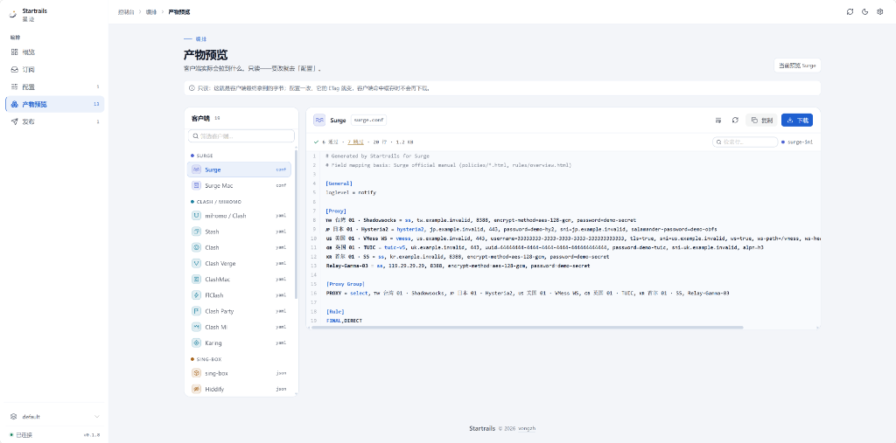

# Startrails · 星迹

<picture>
  <source media="(prefers-color-scheme: dark)" srcset="web/public/brand/logo-on-dark.svg">
  
</picture>

**把多份代理订阅整理为强类型中间表示，按客户端官方文档严格校验后，扇出成 19 个客户端可用的自托管订阅服务（支持桌面端、手机响应式网页控制台与[原生 iOS 客户端](https://github.com/vongzh/startrails-ios)）。**

[](https://github.com/vongzh/startrails/actions/workflows/ci.yml)
[](https://github.com/vongzh/startrails/actions/workflows/docker.yml)
[](LICENSE)

---

## 核心能力

```text
订阅源 / 手动节点 ──解析──▶ 强类型 IR ──能力矩阵──▶ 方言发射器 ──▶ 19 个客户端订阅链接
```

- **不静默降级**：基于各客户端官方文档建立三态能力矩阵（`support` 写出、`unverified` 跳过并附说明、`reject` 整条剔除）。缺少 Reality、obfs、SIP003 等关键参数时宁可剔除并写入诊断，也不生成无法连通的“半成品配置”。
- **多端同源与快照回归**：19 个客户端共享一套中间模型与加工链，并由 `tests/golden.test.ts` 对每组 `IR × Target` 做逐字快照比对，避免改坏已有客户端格式。
- **节点筛选、图标与地理识别**：
  - 支持声明式加工链（`filter` / `rename` / `prefix` / `sort` / `dedupe` / `limit`）与按配置隔离的策略组、规则、DNS / TUN 参数。
  - **策略组自动图标**：在策略组开启后自动按组名用途与国家地区匹配图标（Fluent Emoji 3D / Twemoji / Quantumult X SF Symbols），也可按组覆盖或关闭。
  - **节点地区与 ASN 识别**：按 `手动标注 > 节点名关键词 > 本地离线 IP/ASN 库` 三级推断地区；内置世界点阵地图与 TCP 握手测速（支持识别本地 TUN 劫持与 UDP 节点跳过）。
- **桌面端、手机网页与原生客户端**：
  - Web 控制台针对手机浏览器做了完整响应式适配——窄屏自动切换底部导航栏与顶栏配置切换器，点阵地图、表单卡片与节点列表自适应竖排，触控设备采用 `40×40` 触控热区，随时可在手机上完成节点整理与扫码导入。
  - **原生 iOS / iPadOS 客户端**：基于 SwiftUI + WidgetKit 构建，独立仓库维护于 [`vongzh/startrails-ios`](https://github.com/vongzh/startrails-ios)。
- **自托管与密钥隔离**：全部业务状态保存在单个 SQLite 数据库（WAL 模式），订阅源正文与已签发 Token 使用 `AES-256-GCM` 字段级加密，不依赖任何第三方订阅转换服务。

---

## 界面预览



| 节点分布（世界点阵） | 产物预览（19 客户端） |
| --- | --- |
|  |  |

---

## 客户端与协议支持

目前支持 **7 种方言、19 个客户端**；新增客户端只需在 [`src/core/targets.ts`](src/core/targets.ts) 登记目标，并在 [`src/core/capabilities/verified.ts`](src/core/capabilities/verified.ts) 补充有官方依据的能力差异。

| 方言 | 支持客户端 | 输出形态 |
| --- | --- | --- |
| `surge-ini` | Surge、Surge Mac | INI 完整配置（含策略组、规则与 DNS） |
| `clash-yaml` | mihomo / Clash、Stash、Clash（Legacy）、Clash Verge、ClashMac、FlClash、Clash Party、Clash Mi、Karing | YAML 完整配置（含策略组图标、规则与 DNS/TUN） |
| `sing-box-json` | sing-box、Hiddify | JSON 完整配置（`outbounds`、DNS、路由与入站） |
| `quanx-ini` | Quantumult X | INI 完整配置（`[server_local]`、`[policy]`、`[filter_remote]` 等） |
| `loon-ini` | Loon | INI `[Proxy]` 节点片段（未验证段显式提示用户自补） |
| `egern-yaml` | Egern | YAML 多文档单节点片段 |
| `uri-list` | Shadowrocket、V2Box、Anywhere | 节点分享 URI 列表 |

- **协议与传输**：覆盖 `vless`、`vmess`、`trojan`、`shadowsocks`、`hysteria2`、`tuic`、`anytls`、`snell`，支持 `ws` / `grpc` / `h2` / `http` 传输以及 TLS、VLESS Reality、ShadowTLS / SIP003 插件、Hysteria2 `obfs` 与端口跳跃。
- **四种订阅交付方式**：同一签发 Token 可通过以下形态访问：
  - 托管链接：`GET /s/<token>[/<profile>/<target>]`（自动识别客户端 `User-Agent`，支持 `ETag` / `304`）
  - 扫码导入：`GET /s/<token>/qr.svg`
  - 下载文件：`GET /s/<token>?download=1`
  - 临时参数筛选：`GET /s/<token>?include=HK&exclude=过期&limit=20`
- **容灾反馈**：交付响应头附带 `X-Startrails-Summary: nodes=42 skipped=3 sources=2 stale=1`；上游短暂不可用时自动回退最近可用快照并标记 `stale=1`。

---

## 核心概念与工作流

控制台围绕「**内容来源 → 组装加工 → 产物预览 → 签发交付**」展开：

```text
订阅（远端 / 文件）+ 我的节点（inline） ──▶ 组合订阅（可选复用） ──▶ 配置（发布作用域） ──▶ 预览与发布
```

| 概念 | 说明 |
| --- | --- |
| **订阅** | 上游远端 URL 或本地上传的文件源。远端源支持独立 `User-Agent`、拉取代理（应对分流/限区机场）与刷新策略，可单独停用。 |
| **我的节点** | 手工表单录入或批量粘贴分享链接生成的 `inline` 源，无上游刷新动作，直接参与后续筛选、改名、去重与组合引用。 |
| **组合订阅** | 将多个「订阅 / 我的节点」合成为可复用的中间集合；成员可独立设置前缀、改名模板、过滤规则与节点上限，去重支持 `nodeKey` / `name` / `none`。 |
| **配置** | 最终发布单元。按顺序引用若干订阅、我的节点与组合订阅（顺序即合并顺序），每份配置拥有独立的输出参数与订阅签发台账。 |

- **两档作用域**：
  - **实例级**（全局共享）：管理令牌、加密密钥、数据库备份与恢复、WebDAV、通知渠道、离线 IP 库与构建历史。
  - **配置级**（随配置隔离）：配置构成、节点排除/别名/地区标注/排序、内联规则与规则集、策略组（含图标设置）、DNS / TUN 参数、以及已签发的订阅链接。
- **声明式加工链**：按序执行 `filter`、`rename`、`prefix`、`sort`、`dedupe`、`limit` 等算子；模式字面量自动识别 `/re/flags`（正则）、含 `*` `?`（glob）或普通子串；内置 `useless` 过滤器自动剔除剩余流量、到期时间等说明性伪节点。

---

## 快速部署

需要 **Docker**（推荐）或 **Node.js ≥ 22.18**。默认仅监听 `127.0.0.1:8787`；容器镜像内监听 `0.0.0.0:8787`，宿主机端口映射仍绑定在回环地址。

### 方式一：Docker Compose（推荐）

```bash
# 1. 使用 GitHub Container Registry 已发布镜像（无需源码和构建环境）
docker compose -f docker-compose.release.yml up -d

# 2. 或从当前仓库源码本地构建
cp .env.example .env   # 可选：留空则首次访问 Web UI 时设置密钥与管理令牌
docker compose up -d
```

也可直接用单条 `docker run` 启动：

```bash
docker run -d --name startrails \
  -p 127.0.0.1:8787:8787 \
  -v startrails-data:/app/data \
  --restart unless-stopped \
  ghcr.io/vongzh/startrails:latest
```

### 方式二：源码运行

```bash
npm ci
npm run build:ui
node src/server/index.ts
```

### 首次访问与密钥说明

1. 启动后访问 `http://127.0.0.1:8787`，首次进入会引导设置 **管理令牌** 与 **数据加密密钥**。
2. **数据加密密钥（`STARTRAILS_TOKEN_SECRET`）**：用于加密库内源正文和订阅 Token 明文，优先级为 `环境变量 > STARTRAILS_SECRET_FILE（默认 <data>/secret.key） > 首次在 Web UI 设置`。**已有数据的实例更换密钥会导致旧正文与台账地址无法解密**（已签发给客户端的哈希校验不受影响）。
3. **管理令牌（`STARTRAILS_ADMIN_TOKEN`）**：环境变量优先级高于数据库哈希，若忘记令牌可通过设置环境变量临时接管或从备份恢复。

### 反向代理与数据备份

对外提供 HTTPS 访问时，**务必配置 `STARTRAILS_PUBLIC_BASE_URL=https://sub.example.com`**，确保二维码、规则集镜像改写与客户端导入链接使用正确域名：

```nginx
location / {
  proxy_pass http://127.0.0.1:8787;
  proxy_set_header Host $host;
  proxy_set_header X-Forwarded-Proto $scheme;
  client_max_body_size 16m;
}
```

> 备份直接使用 SQLite `VACUUM INTO` 热快照，支持本机导出与 WebDAV 远端上传；切勿在运行中直接 `cp` 拷贝 WAL 模式数据库文件。完整步骤见 [`docs/BACKUP.md`](docs/BACKUP.md)。

<details>
<summary>裸机 systemd 部署示例</summary>

```bash
sudo useradd -r -s /usr/sbin/nologin startrails
sudo install -d -o startrails -g startrails /opt/startrails /var/lib/startrails
sudo -u startrails git clone https://github.com/vongzh/startrails.git /opt/startrails
cd /opt/startrails && sudo -u startrails npm ci && sudo -u startrails npm run build:ui
sudo -u startrails npm prune --omit=dev
```

```ini
# /etc/systemd/system/startrails.service
[Unit]
Description=Startrails
After=network-online.target

[Service]
User=startrails
WorkingDirectory=/opt/startrails
EnvironmentFile=/etc/startrails.env
ExecStart=/usr/bin/node src/server/index.ts
Restart=always
RestartSec=3
NoNewPrivileges=true
ProtectSystem=strict
ReadWritePaths=/var/lib/startrails

[Install]
WantedBy=multi-user.target
```

在 `/etc/startrails.env`（权限 `600`）中至少配置 `STARTRAILS_DATA_DIR=/var/lib/startrails`。

</details>

<details>
<summary>镜像发布与构建说明（维护者参考）</summary>

- 工作流位于 [`.github/workflows/docker.yml`](.github/workflows/docker.yml)，推送 `v*` 标签（需与 `package.json` 版本一致）会自动执行完整 `verify` 后交叉构建 `linux/amd64` 与 `linux/arm64` 镜像至 GHCR。
- 若需同步推送至 Docker Hub，在仓库设置中添加 `DOCKERHUB_USERNAME`（Variable）与 `DOCKERHUB_TOKEN`（Secret）。
- 使用 Podman 本地构建请加 `--format docker`，避免默认 OCI 格式丢弃 `HEALTHCHECK` 指令；`docker-compose.release.yml` 默认使用 `TZ: CST-8` 以兼容无 `tzdata` 的 Alpine 基础镜像。

</details>

---

## 原生 iOS 客户端

原生 iOS / iPadOS 客户端（SwiftUI + WidgetKit 桌面小组件）独立维护于 [**vongzh/startrails-ios**](https://github.com/vongzh/startrails-ios)，支持多实例切换、离线世界点阵地图、本机 TCP 握手测速、策略组与分流规则编排以及 19 款客户端 URL Scheme 一键拉起导入。

---

## 离线 IP 库与世界点阵地图

- **离线 IP 国家与 ASN 库（可选）**：
  - 数据源来自 `sapics/ip-location-db`，在控制台 **设置 → 备份与缓存** 页面点击「下载 / 更新」，或执行 `npm run geo:update` 即可将 CSV 编译为本地只读二进制索引（存于 `<dataDir>/geo/`）。
  - 支持 IPv4 / IPv6、自动跳过私网地址、单飞 DNS 并发合并，以及多 A/AAAA 解析跨国家冲突保护（存在地区冲突时不误判国家）。
- **世界点阵地图**：
  - 节点页默认以世界点阵展示节点地理分布（点阵视图下隐藏明细表格），并在右上角支持切换 `点阵 | 列表`；静态网格模块位于 [`web/src/data/world-dot-map.ts`](web/src/data/world-dot-map.ts)，如需从 Natural Earth 重建可运行 `npm run worldmap:update`。

---

## 环境变量

完整注释模板见 [`.env.example`](.env.example)。

| 变量 | 默认值 | 说明 |
| --- | --- | --- |
| `STARTRAILS_TOKEN_SECRET` | 空 | 字段级加密密钥（优先于 `secret.key`） |
| `STARTRAILS_SECRET_FILE` | `<data>/secret.key` | Web UI 设置密钥时的落盘路径 |
| `STARTRAILS_ADMIN_TOKEN` | 空 | 控制台管理令牌（覆盖库内哈希） |
| `STARTRAILS_DATA_DIR` | `./data` | 数据目录（SQLite 库、缓存、离线 Geo 库） |
| `STARTRAILS_DB_PATH` | `<data>/startrails.db` | 数据库文件路径 |
| `STARTRAILS_HOST` / `STARTRAILS_PORT` | `127.0.0.1` / `8787` | 服务端监听地址与端口 |
| `STARTRAILS_PUBLIC_BASE_URL` | 空 | 对外访问基地址（TLS 反代时必设） |
| `STARTRAILS_WEBDAV_URL` / `_USER` / `_PASS` | 空 | WebDAV 远端备份目录与凭据 |
| `STARTRAILS_TG_BOT_TOKEN` / `_CHAT_ID`、`STARTRAILS_BARK_URL` | 空 | 构建与异常通知渠道（Telegram / Bark） |
| `STARTRAILS_ALLOW_PRIVATE` | `0` | **慎用**：放行内网订阅地址，仅本机调试使用 |
| `STARTRAILS_ALLOW_STATELESS` | `0` | **慎用**：开放无状态转换接口 `GET /sub?url=` |

---

## 开发与架构

```bash
npm run serve         # 构建前端并启动完整服务（http://127.0.0.1:8787）
npm run dev:ui        # 启动 Vite 前端开发服务器
npm run dev:server    # 启动后端服务
npm test              # 运行全量测试（当前 219 个用例）
npm run verify        # 提交前完整检查：版本一致 → tsc → UI 绑定 → 前端构建 → 全量测试 → 备份演练
```

### 目录结构

- `src/core/`：零 IO、零 `node:` 依赖的同构核心（IR 定义与校验、订阅解析、三态能力矩阵、加工算子、策略组图标匹配、7 种方言发射器与诊断）。
- `src/server/`：HTTP 服务、管理与交付路由、上游拉取调度、离线 Geo 编译检索、节点测速、WebDAV 备份与通知。
- `src/store/`：SQLite 存储层与 AES-GCM 加解密适配。
- `web/`：Vue 3 + Vite + Naive UI 控制台前端。
- `scripts/`：版本校验、UI 绑定静态检查、备份演练、Geo 与世界地图生成脚本。
- `tests/`：能力矩阵、协议往返、golden 快照、加工链、Geo 与全栈管理流程测试。

---

## 常见问题

- **为什么某个客户端输出的节点比控制台里少？**
  这不是丢节点，而是能力矩阵判定结果。可在控制台 **设置 → 能力矩阵** 查看该客户端对目标协议或传输特性的官方文档依据及 `unverified` / `reject` 状态。
- **节点数是 0 怎么排查？**
  依次检查：1）当前「配置」是否已把订阅或我的节点加入构成列表；2）订阅源是否处于停用状态；3）**设置 → 诊断** 中的 `reason` 字段（如 `profile-empty`、`source-unavailable`）。
- **客户端迟迟拉不到最新配置？**
  交付接口默认启用 `ETag / 304` 协商缓存。可先在 **产物预览** 页切换对应客户端重新构建确认内容已变更，再检查反代或客户端自身刷新间隔。
- **支持多副本部署吗？**
  不支持。SQLite WAL 要求同一主机本地卷单实例独占写入，不能挂载 NFS/CIFS 网络存储或同时启动多个写副本。

---

## 合规、致谢与许可证

- **合规与免责**：本项目仅提供代理配置解析、整理与格式转换能力，不提供、不代理、不分发任何网络接入服务。请遵守当地法律法规与上游服务条款；协议字段映射仅依据公开文档与格式规范。
- **第三方致谢**：设计借鉴、图标 CDN 与开源地理数据集归属详见 [`THIRD-PARTY-NOTICES.md`](THIRD-PARTY-NOTICES.md)。
- **许可证**：[MIT](LICENSE) © 2026 vongzh
